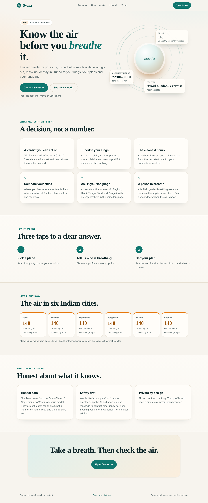
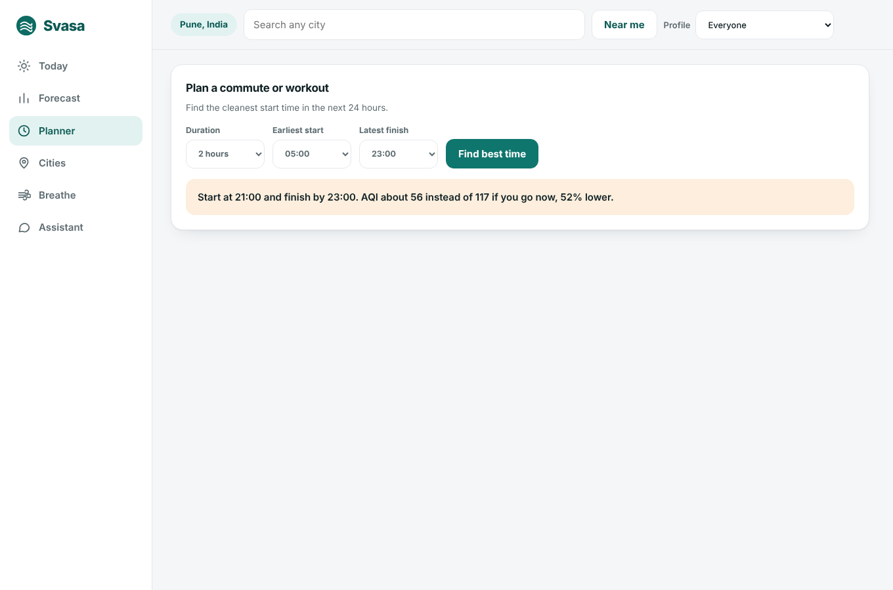
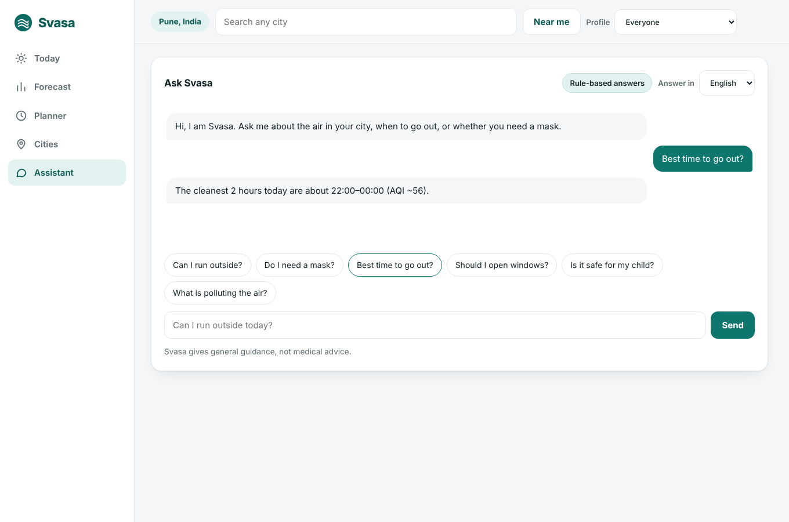

# Svasa

Urban air quality assistant. Live AQI for any city, advice tuned to your health profile, an hourly forecast, a trip planner, city comparison and an AI assistant powered by Gemini.

## Screenshots
Sample data, rendered in a headless browser.



| Today | Forecast |
|---|---|
|  |  |
|  |  |


## Features
- Landing page with live readings for six Indian cities
- Ground check: nearest OpenAQ monitoring station compared with the model (needs `OPENAQ_API_KEY`)
- Guided breathing exercise (4-4-6) that reads the current air quality
- Live US AQI with an India NAQI estimate, pollutant breakdown against WHO guidelines
- Health profiles (asthma, child, older adult, and more) with tailored advice
- 24-hour forecast, cleanest-window finder, 7-day history
- Commute and workout planner with a time range
- City comparison with one-tap popular cities, recent searches, threshold alerts, offline snapshot, installable PWA
- Assistant answers in English, Hindi, Telugu, Tamil and Bengali, with localised emergency messages
- Gemini assistant with a safety layer for emergencies

## Project structure
```
svasa/
├── frontend/          Static web app (no build step)
│   ├── index.html     Landing page
│   ├── app.html       The app
│   ├── css/           styles.css (app), landing.css
│   ├── js/app.js      App UI and views
│   ├── js/landing.js  Landing page live ticker
│   ├── js/core.js     Shared logic (also used by the backend)
│   ├── sw.js, manifest.json, icon.svg, icons/
├── backend/           API logic and local server
│   ├── routes/        ask.js, health.js
│   ├── lib/           gemini.js, guard.js
│   └── server.js      Local and Docker server
├── api/               Vercel serverless entry points (thin wrappers)
├── tests/             Unit, server and serverless tests
├── docs/              PRD.md, SECURITY.md, DEMO.md, screenshots/
├── vercel.json, Dockerfile, package.json
```

## Run locally
Requires Node 18 or newer. No dependencies to install.
```bash
export GEMINI_API_KEY="your_key"     # Windows PowerShell: $env:GEMINI_API_KEY="your_key"
npm start                            # http://localhost:8080
npm test
```
Without a key the app still works with rule-based answers.

## Configuration
| Variable | Required | Default |
|---|---|---|
| `GEMINI_API_KEY` | For AI answers | none |
| `GEMINI_MODEL` | No | `gemini-2.5-flash` |
| `OPENAQ_API_KEY` | For the ground-station check | none |
| `PORT` | No | `8080` |

## Deploy to Vercel
1. Push this repo to GitHub and import it at vercel.com/new.
2. Add `GEMINI_API_KEY` under Settings, Environment Variables.
3. Deploy. Vercel serves `frontend/` and the functions in `api/`.

Check `/api/health`: it should return `{"ok":true,"ai":true}`.

## API
- `GET /api/health` returns service, AI and station status.
- `GET /api/stations?lat=&lon=` returns the nearest OpenAQ station with PM2.5.
- `POST /api/ask` takes `{ q, ctx }` and returns `{ answer, source }`.

## Data and limits
Air data comes from Open-Meteo (CAMS model estimates), not ground monitors. Guidance is general and not medical advice. See `docs/SECURITY.md` for security notes.

## SVASA 4 upgrade branch
The Smart Day Planner minimizes caution windows first and outdoor PM2.5 concentration-time proxy second, using up to four ordered activities with fixed or flexible timing. This proxy is not an inhaled dose or a predicted health outcome. Family profiles stay in browser storage. India NAQI display and direct current-to-WHO comparisons are withheld pending scientifically valid coverage and averaging. Alerts are in-app only.

The assistant now accepts `{q,place:{lat,lon},ctx:{profile,lang,hist}}` and fetches its own model context in UTC. The evidence object identifies the provider and observation time; this is not independently measured ground truth. Reports save explicitly selected forecast-based schedules locally for seven-day review and JSON export. Station data has sensor-specific timestamps and is compared only when recent. No true background push or official India NAQI is claimed.
