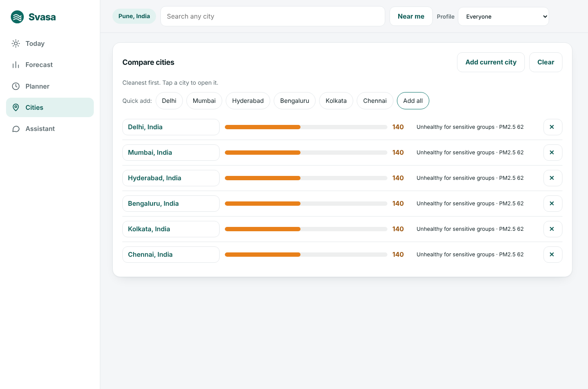
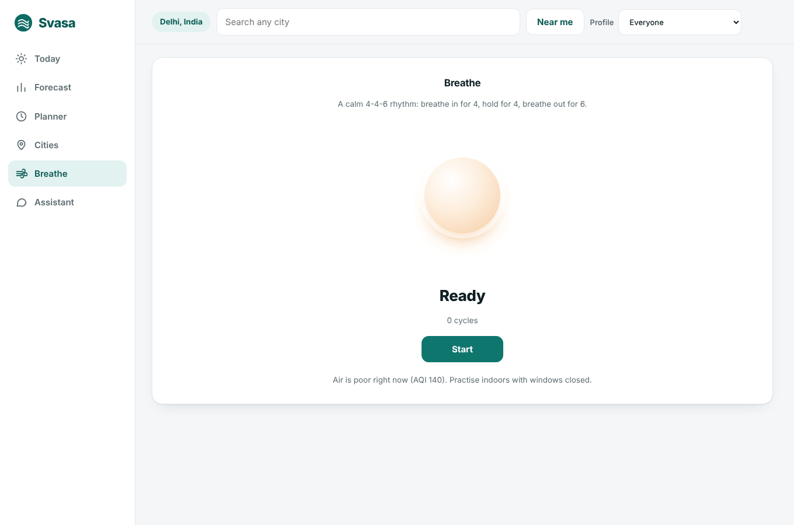
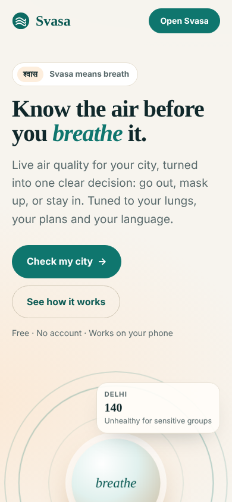
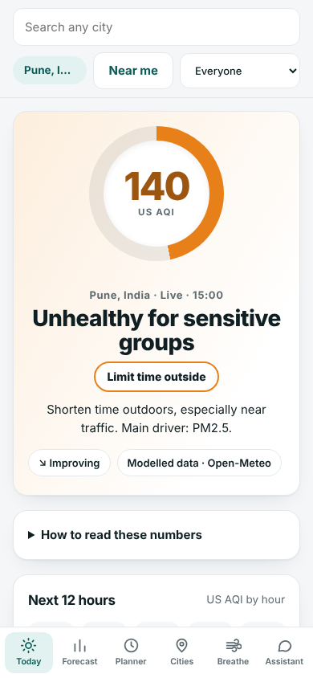

# SVASA · Personal Air Intelligence

**Don't just monitor the air. Plan a better day.**

SVASA turns air-quality forecasts into practical, constraint-aware outdoor decisions. Compare alternative routines, keep fixed commitments, review changing forecasts, protect family members and record completed plans. Built as an installable, responsive web application with a premium light interface.

[**Live application**](https://svasa-sage.vercel.app/) · [Automated verification](https://github.com/Pavan3030-pr/Svasa/actions) · [90-second judge demo](docs/DEMO.md) · [Release evidence](docs/RELEASE-EVIDENCE.md)

## Application gallery

<!-- SVASA_GALLERY_START -->
The original screenshots are restored below while the new verified browser capture workflow publishes the updated interface. These images are from an earlier release; see the [latest browser evidence](https://github.com/Pavan3030-pr/Svasa/actions) for current captures.

### Landing page


### Air-quality dashboard


| Day planner | Forecast |
|:---:|:---:|
|  |  |

| AI assistant | City comparison |
|:---:|:---:|
|  |  |

### Guided breathing


| Mobile landing | Mobile dashboard |
|:---:|:---:|
|  |  |
<!-- SVASA_GALLERY_END -->

## What makes SVASA different

| Capability | What it does |
|---|---|
| **Parallel Futures** | Compare preferred and optimized activities side by side with a transparent projected outdoor PM2.5 concentration-time proxy. |
| **Adaptive Day** | Re-evaluate a saved schedule against refreshed forecasts; preserve fixed commitments and review changes before accepting. One locally saved plan can be restored for up to 48 hours. |
| **AirTrust** | Show forecast coverage, ground-station freshness, proximity and material source disagreement without inventing a confidence probability. |
| **Family Protection** | Rank a shared one-hour window by the number of profiles needing caution, then PM2.5 and AQI. |
| **AI decision verification** | Ground Gemini answers in server-verified air data; check response structure, language script, numerical claims and selected safety constraints. Emergency bypass and labelled fallback remain available. |
| **Impact Ledger** | Record saved projected schedules and self-reported completion, with undo and optional local export. |

The planner uses dynamic programming to find an exact optimum under either of two priorities: after minimizing caution activities, minimize the forecast concentration-time proxy or the total hours shifted. Fixed commitments stay fixed. It supports up to four ordered outdoor activities. Neither the proxy nor completion is measured exposure, an inhaled dose or a health outcome.

Other modules: live model dashboard, hourly and historical forecast, trip planning, city comparison, guided breathing, multilingual assistant, notifications and opt-in daily push, offline snapshots with stale-data planning disabled, and PWA installation where supported.

## Architecture

```text
Browser · responsive HTML/CSS · generated JS · service worker
  ├─ Open-Meteo / CAMS → model air quality, forecast, geocoding, weather
  └─ Vercel APIs / Node server
       ├─ Server-verified air context → Gemini / deterministic guidance
       ├─ OpenAQ → nearby ground observations
       └─ Upstash Redis → rate limits, provider budget, push subscriptions
```

Shared decision logic: `frontend/js/core.js` and `frontend/js/intelligence.js`. Reports and notifications have dedicated modules. Browser bundles and inline style CSP hashes are synchronized by checked scripts. The service worker never caches API responses. One direct runtime dependency is locked with integrity hashes.

## Verification

- [GitHub Actions](https://github.com/Pavan3030-pr/Svasa/actions): unit, contract, outage, security, desktop/mobile browser and real production journeys. Automated axe WCAG A/AA checks reject detected violations in tested views.
- [Release evidence](docs/RELEASE-EVIDENCE.md): the seeded 500-case exhaustive optimizer comparison passed on commit `ecdd6e4` (488 feasible cases and 23,470 enumerated candidate schedules). Synthetic validation only.
- Lighthouse gates require at least 90 performance, 100 accessibility, 95 best practices and 95 SEO for tested pages; these are engineering floors, not promises of perfect field scores.
- The production capacity test covers 24 read-only requests at four concurrent clients, not maximum-scale load.
- The strict five-language Gemini evaluation requires actual model responses; explicit fallback is not a live-model pass. Provider rate limits are respected, reported and retried within bounds.

Screenshots captured by the fixture browser suite document actual rendered UI with controlled data, not clinical evidence, live readings or real participant feedback. See the current CI artifacts for independent live production browser evidence.

## Run locally

Node 26.x, as pinned in package.json:

```sh
npm ci
npm test
npm start
# http://localhost:8080
```

The dashboard works without a Gemini key; optional backend services use these server environment variables.

| Variable | Purpose |
|---|---|
| `GEMINI_API_KEY` / `GEMINI_MODEL` | Live model responses; default gemini-2.5-flash |
| `GEMINI_DAILY_LIMIT` | Shared daily outbound attempt limit, default 300 |
| `OPENAQ_API_KEY` | Ground station observations |
| `UPSTASH_REDIS_REST_URL` / `UPSTASH_REDIS_REST_TOKEN` | Distributed limits and push storage; KV_REST aliases supported |
| `VAPID_PUBLIC_KEY` / `VAPID_PRIVATE_KEY` / `VAPID_SUBJECT` | Push identity |
| `CRON_SECRET` | Authenticated scheduler |
| `PUSH_MAX_SUBSCRIPTIONS` | Default 60; allowed 20–120 |
| `PORT` | Local port, default 8080 |

Keep secrets out of Git and browser code. Import the repository into Vercel and configure production environment variables. The daily cron checks subscribed fixed cities, not moving locations.

After changing CSS or JS, regenerate checked-in assets:

```sh
npm run sync:styles
npm run sync:landing
npm run sync:app
```

## Safety and privacy

Model forecasts are area estimates; station readings may differ in location and averaging period. The India-scale indicator is partial, not official CPCB AQI. Guidance is precautionary, not medical advice. AI queries send selected coordinates, profile and bounded context to the server/model provider. Family profiles, adaptive plans, reports and voluntary feedback stay on-device unless exported. Optional push subscriptions store a fixed city and endpoint, expire after 30 days and can be revoked.

Independent clinical, security and native-language semantic review, physical-device push delivery and genuine participant usability remain unverified. The project does not claim world-first functionality or guaranteed safety.

[Product requirements](docs/PRD.md) · [Security and operational limits](docs/SECURITY.md) · [Health guidance](docs/HEALTH-GUIDANCE.md) · [Prompt engineering](docs/PROMPT-ENGINEERING.md) · [Volunteer validation protocol](docs/USER-VALIDATION.md)
