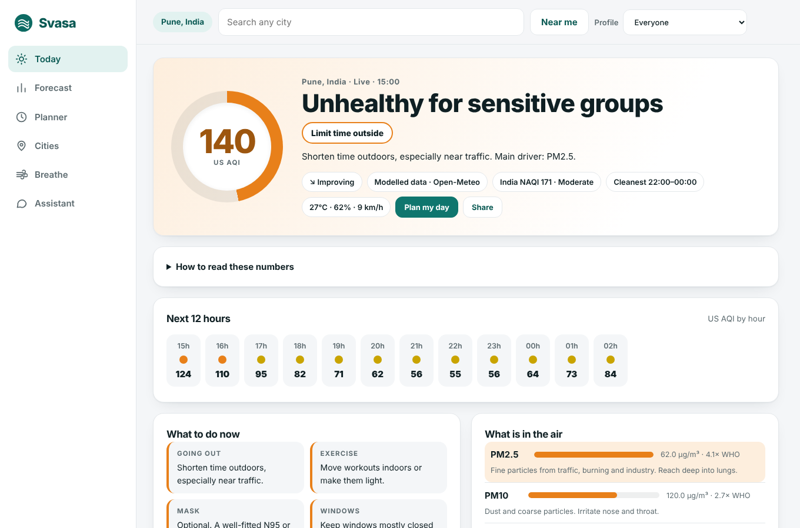
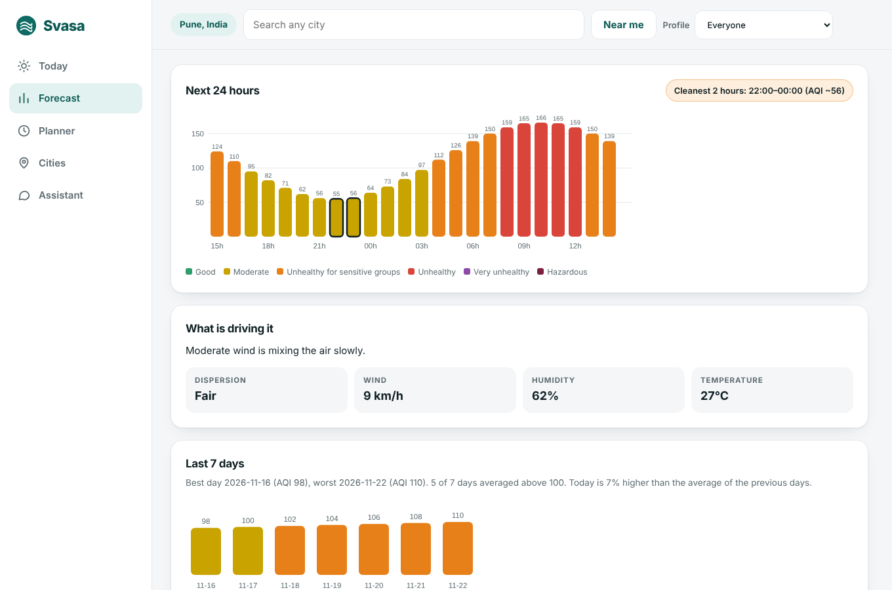

# Svasa

Urban air quality assistant. Live AQI for any city, advice tuned to your health profile, an hourly forecast, a trip planner, city comparison and an AI assistant powered by Gemini.

## Screenshots
Sample data, rendered in a headless browser.


| Today | Forecast |
|---|---|
|  |  |
|  |  |


## Features
- Landing page with live readings for six Indian cities
- Ground check: nearest OpenAQ monitoring station compared with the model (needs `OPENAQ_API_KEY`)
- Guided breathing exercise (4-4-6) that reads the current air quality
- Live modelled US AQI and current pollutant concentrations with source limitations
- Health profiles (asthma, child, older adult, and more) with tailored advice
- 24-hour forecast, cleanest-window finder, 7-day history
- Commute and workout planner with a time range
- City comparison with one-tap popular cities, recent searches, threshold alerts, offline snapshot, installable PWA
- Assistant answers in English, Hindi, Telugu, Tamil and Bengali, with localised emergency messages
- Gemini assistant with a safety layer for emergencies

## Project structure
```
svasa/
├── frontend/          Static web app (no build step)
│   ├── index.html     Landing page
│   ├── app.html       The app
│   ├── css/           styles.css (app), landing.css
│   ├── js/app.js      App UI and views
│   ├── js/landing.js  Landing page live ticker
│   ├── js/core.js     Shared logic (also used by the backend)
│   ├── sw.js, manifest.json, icon.svg, icons/
├── backend/           API logic and local server
│   ├── routes/        ask.js, health.js
│   ├── lib/           gemini.js, guard.js
│   └── server.js      Local and Docker server
├── api/               Vercel serverless entry points (thin wrappers)
├── tests/             Unit, server and serverless tests
├── docs/              PRD.md, SECURITY.md, DEMO.md, screenshots/
├── vercel.json, Dockerfile, package.json
```

## Run locally
Use the Node version specified in package.json (Node 26.x). Run npm install for the optional Web Push transport.
```bash
export GEMINI_API_KEY="your_key"     # Windows PowerShell: $env:GEMINI_API_KEY="your_key"
npm start                            # http://localhost:8080
npm test
```
Without a key the app still works with rule-based answers.

## Configuration
| Variable | Required | Default |
|---|---|---|
| `GEMINI_API_KEY` | For AI answers | none |
| `GEMINI_MODEL` | No | `gemini-2.5-flash` |
| `OPENAQ_API_KEY` | For the ground-station check | none |
| `PORT` | No | `8080` |

## Deploy to Vercel
1. Push this repo to GitHub and import it at vercel.com/new.
2. Add `GEMINI_API_KEY` under Settings, Environment Variables.
3. Deploy. Vercel serves `frontend/` and the functions in `api/`.

Check `/api/health`: it should return `{"ok":true,"ai":true}`.

## API
- `GET /api/health` returns service, AI and station status.
- `GET /api/stations?lat=&lon=` returns the nearest OpenAQ station with PM2.5.
- `POST /api/ask` takes `{ q, place:{lat,lon}, ctx:{profile,lang,hist} }` and returns `{ answer, source, evidence }` for grounded AI responses.

## Data and limits
Air data comes from Open-Meteo (CAMS model estimates), not ground monitors. Guidance is general and not medical advice. See `docs/SECURITY.md` for security notes.

## SVASA 4
The Smart Day Planner minimizes caution windows first and outdoor PM2.5 concentration-time proxy second, using up to four ordered activities with fixed or flexible timing. This proxy is not an inhaled dose or a predicted health outcome. Family profiles stay in browser storage. The India-scale model estimate is partial and displayed only when coverage requirements are met; WHO comparisons use matching averaging periods. In-app alerts are always available where supported; optional background alerts require deployment setup.

The assistant now accepts `{q,place:{lat,lon},ctx:{profile,lang,hist}}` and fetches its own model context in UTC. The evidence object identifies the provider and observation time; this is not independently measured ground truth. Reports save explicitly selected forecast-based schedules locally for seven-day review and JSON export. Station data has sensor-specific timestamps and is compared only when recent. Background push requires configured infrastructure; official India NAQI is not claimed.

Gemini requests use a structured JSON response contract with recommendation, reason and limitation. Malformed responses and selected unsupported numerical AQI or dangerous reassurance patterns are rejected. This is a limited validation layer, not proof of factual or clinical correctness. The AI contract suite is deterministic and does not call the live model.

### Scientific method and optional shared rate limit
The partial India-scale display uses up to six model pollutant components (PM2.5, PM10, NO2, SO2 with 16 of 24 hourly samples; CO and O3 with eight of eight hourly samples). At least three components including PM are required. NH3 and lead are unavailable for India from this model; the estimate may understate the complete index and must not be confused with official CPCB monitoring-station readings. Method reference: https://ies.gov.in/arthapedia/concept/national-air-quality-index . WHO comparisons require 24 complete model hours. Set UPSTASH_REDIS_REST_URL and UPSTASH_REDIS_REST_TOKEN on the server to enable atomic shared per-key rate limits. Without both, the existing local limiter is used. The health endpoint exposes configuration status only, not secrets or a live connectivity check. When configured and unavailable, protected endpoints fail closed.

### Quality evidence
GitHub Actions runs syntax checks, unit and mocked API integration tests, HTTP smoke checks, browser workflows and axe accessibility reports. Browser screenshots and accessibility findings are uploaded as workflow artifacts. A separate Lighthouse workflow records local performance/accessibility/best-practices/SEO scores, rather than declaring unmeasured targets met. It may depend on network availability and is not a live-provider certification.

### Performance design
The application uses system typography without third-party font downloads. Air data is rendered before optional weather, and forecast charts and city comparisons are loaded when needed. The service worker caches known static assets only and never caches APIs. Lighthouse results vary with network and runner conditions.

### Optional background Web Push (pilot)
Run `npm install` and `npx web-push generate-vapid-keys` locally. Set server-only VAPID_PRIVATE_KEY, VAPID_PUBLIC_KEY, VAPID_SUBJECT (mailto:your contact), CRON_SECRET (random secret), UPSTASH_REDIS_REST_URL and UPSTASH_REDIS_REST_TOKEN. Configure a scheduler to send GET /api/push?dispatch=1 with Authorization: Bearer <CRON_SECRET> at the desired cadence. A daily Vercel cron invokes /api/push-dispatch at 01:00 UTC (06:30 IST, subject to scheduling jitter). It safely skips when background push is not configured. Vercel plan limits apply; daily checks are not real-time. Pilot cap: 20 subscriptions; 30-day expiry. The browser stores a random ownership token; Redis stores a hash, selected coordinates rounded to 0.01 degrees, AQI threshold and the push subscription. No health profile, nickname or moving-location tracking is stored. A notification is sent when the selected threshold is crossed at a scheduled check. Not a real-time or emergency alert. Chrome/Firefox/Safari provider host allowlist; unsupported providers are rejected. Disabled when configuration is missing. Live delivery requires an opted-in browser and configured infrastructure.

Production smoke verification runs against the public deployment and records the health/build status, emergency path and configured real Gemini and OpenAQ responses. An unconfigured provider is reported as such, not counted as a live integration pass. The push configuration check is not proof of delivery.

The browser checks provider configuration before requesting optional station data or Gemini. Missing credentials are displayed as a disabled capability, not repeatedly requested as failing endpoints. The station panel also rejects invalid measurement values.

Mobile performance improvements defer script execution, keep the AQI summary visible, remove unnecessary animations, load below-fold city readings on proximity and compress static responses in the local server. Optional views populate when opened. Standard Lighthouse throttling remains unchanged.

Vercel Marketplace Redis credentials may be named `KV_REST_API_URL` and `KV_REST_API_TOKEN`; these aliases are supported. The production smoke suite checks four additional language scripts, the structured response and evidence, and unauthenticated scheduler rejection. It does not assess translation or clinical quality. The dispatch unit test uses an injected transport/storage fixture, not live notifications.

The optional notification test button sends only to the current browser's owned subscription, with a five-minute server cooldown. VAPID public/private key correspondence is checked before background alerts are enabled. A push-service acceptance is not evidence of OS-level delivery; confirm the device notification manually.

Native-script validation is enforced in each non-English response field. One bounded retry is allowed for malformed or wrong-language AI output; unsupported responses fail closed. Production tests report HTTP status, source and per-field script checks without recording user conversation text.

Gemini HTTP 429 responses produce explicitly labelled, localized rule-based general guidance from fresh server data. This is not counted as a live Gemini success. Production live language requests are paced and quota-limited evaluations remain incomplete (nonzero exit), rather than being misreported as passing.
